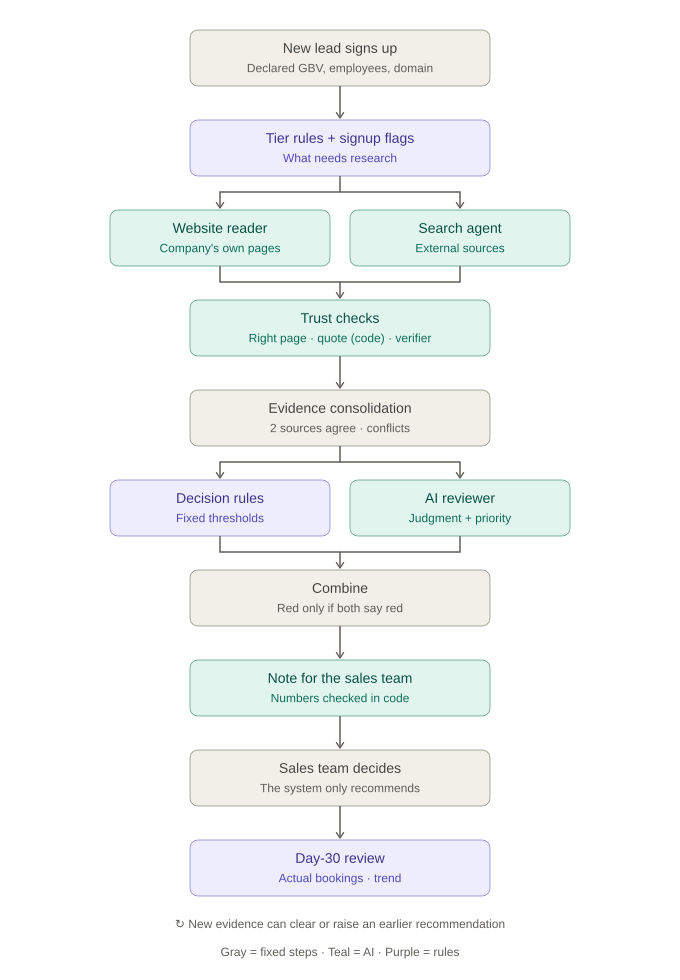

# Lead Tier Routing: System Spec

*Working spec for the Navan Growth home assignment. Source for the final presentation. Every decision below is traced in `work-log.md`.*

---

## 1. Summary

When a business signs up, Navan routes it to a support tier using two inputs: the travel spend the customer **declares** (GBV) and, when available, an **estimated** employee count. Both can be wrong or incomplete.

This system adds **research and judgment** on top of those inputs. For every new lead it:

1. Collects evidence from the company's website and from external sources.
2. Keeps only facts that pass several trust checks.
3. Combines **fixed rules** with an **independent AI review** to produce a recommendation: 🟢 tier fits, 🟡 review, or 🔴 consider a higher tier.
4. Writes a short, sourced note for the sales rep.
5. Re-checks the recommendation after 30 days, using real booking activity.

**The system never changes a tier.** A person always decides.

---

## 2. The problem

| Today | Gap |
|---|---|
| Tier = declared GBV + estimated headcount | Declared GBV is a customer guess. Headcount is often missing (20 of 43 companies in the dataset) |
| Rules are applied correctly | In the dataset, the current tier matches the rules for **all 43 companies**. The rules are not the problem - **their inputs are** |
| One decision at signup | No mechanism to revisit the tier when real activity arrives |

**Goal:** surface companies whose tier may not fit, in **either direction**, and companies with unusual growth potential. Do this with evidence a sales rep can check, and without flooding reps with unnecessary reviews.

---

## 3. Principles

These held across every stage and drove most design decisions.

1. **The system only recommends.** Even 🔴 does not change a tier. A rep decides.
2. **No evidence, no flag.** Missing information is noted, not flagged.
3. **Every recommendation explains itself**, including 🟢. Which rule fired, on which facts, from which source.
4. **AI reads and judges. Code checks and decides.** AI is used where text must be understood or judged. Code is used where results must be consistent, cheap and auditable.
5. **Never trust a model output without a check in code.** Quotes, URLs and numbers produced by an LLM are verified against the source text.
6. **Downgrades need stronger evidence than upgrades.** A missed upgrade costs a rep's time. A wrong downgrade can cost a customer.
7. **Measure before tuning.** Prompt changes are judged by metrics on a held-out set, not by fixing one company at a time.

---

## 4. Architecture

**Legend:** gray = code, teal = AI, purple = rules.

| # | Stage | Type |
|---|---|---|
| 1 | Tier rules + signup flags | Rules |
| 2 | Website agent | AI |
| 3 | Search agent | AI |
| 4 | Trust checks | AI + code |
| 5 | Evidence consolidation | Code |
| 6 | Decision rules | Rules |
| 7 | AI reviewer | AI |
| 8 | Combine | Code |
| 9 | Note for the rep | AI + code check |
| 10 | Day-30 review | Rules |

---

## 5. Stages

### 5.1 Tier rules + signup flags

**What it does.** Calculates the tier from the assignment's rules, and raises flags that say *what needs research*. These flags trigger research. They are not decisions.

**How.** Code only.
- Tier 1: GBV ≥ $500K. Tier 2: GBV ≥ $100K **or** ≥ 150 employees. Tier 3: everything else.
- Signup flags:

| Flag | Meaning |
|---|---|
| `MISSING_SIZE` | No employee estimate - the tier rests on declared GBV alone |
| `GBV_LOW_FOR_SIZE` | The tier by headcount is higher than the tier by GBV |
| `GBV_HIGH_FOR_SIZE` | The tier by headcount is lower than the tier by GBV |
| `NEAR_THRESHOLD` | Within 20% below the next tier's threshold |

**Decisions.**
- **How to compare GBV with headcount without inventing a number.** We tried two approaches and rejected both:
  - A fixed $/employee threshold. Rejected because the numbers were arbitrary.
  - A "share of employees who travel" ratio. Rejected because it turned out to be the same fixed threshold in disguise.
- **Chosen: the ratio Navan's own rules imply.** $100K and 150 employees both open Tier 2, so we use **~$667 per employee** to translate headcount into an implied tier. This is stated as an explicit assumption, not a Navan fact.
- **Flag names describe the finding, not a verdict.** `GBV_LOW_FOR_SIZE` instead of `UNDER_TIERED`, because the flag cannot know which of the two numbers is wrong.
- Tiers are represented as an ordered type with a helper `is_higher()`, because "Tier 1 is higher than Tier 3" is easy to get backwards in code.

**Interesting.** 30 of 43 companies get at least one signup flag. 20 of them only because headcount is missing, which is cheap automated research, not rep time.

---

### 5.2 Website agent

**What it does.** Reads the company's own website and extracts facts: employees, industry, countries, parent company, funding, hiring.

**How.**
1. **Code** finds the info pages (about, careers, contact, news, sectors, modern-slavery) from the homepage links, then downloads and saves them.
2. **AI** (Claude Haiku) extracts facts using **structured outputs**: a fixed schema where every fact has `field`, `value`, `quote`, `source_url` and `source_date`.

**Decisions.**
- **Keywords in code, not an LLM, to find pages.** We measured first: keywords found 2+ pages for 10 of 11 companies. The one failure (Instinct) is a genuinely ambiguous company. The LLM fallback was not needed.
- **Fixed schema and an allowed field list.** The model fills a form. It cannot invent new fields or answer in free text.
- **Pages are saved.** The quote check needs the exact text the model read, and experiments can be repeated without re-downloading.
- **Privacy.** Pages about leadership and team members are skipped.

**Improvements.**
- Keyword matching on link text caught irrelevant pages ("for teams", "help"). We switched to matching URL paths.
- "First 4 pages" returned four variants of "about" for large companies. We switched to one page per page type.
- A one-off analysis of words that repeat across sites added `news`, `sectors` and `modern-slavery` to the page types.

**Interesting.**
- **`modern-slavery` pages are a size signal.** UK companies above roughly £36M turnover must publish a modern-slavery statement. The page appeared for exactly the three large companies (Balfour Beatty, Ageas, Dalkia) and not for the small one. *(The threshold should be verified against an official source before it is used.)*
- **The homepage alone is marketing.** Attio's homepage had no headcount, offices or company facts.

---

### 5.3 Search agent

**What it does.** Finds independent external sources (news, company databases, Wikipedia) and extracts facts from them.

**How.**
1. **AI with a web search tool** decides what to search, up to 3 searches per company, and returns up to 5 URLs. This is the only true "agent" in the system: it chooses its own actions.
2. **Code** keeps only URLs that actually appeared in the search results, so the model cannot invent a link. It also drops the company's own domain.
3. **Code** downloads the pages. From there, the same extraction and checks as the website agent are used.

**Decisions.**
- **Reuse the existing pipeline.** The search agent only finds URLs. Downloading, extraction and checks are shared with the website agent, so both agents produce facts in the same format.
- **UK Companies House API: deferred.** The API is official, free and structured, so it would need no AI. It is planned but not built, because registration requires a GOV.UK One Login identity process. **In production we would add it as a third source.** Its public pages are still reachable through the search agent.
- **Cheapest model that works.** We tested whether Claude Haiku supports the web search tool before building. It does, and the basic tool version used fewer tokens.

**Interesting.**
- **Company databases block automated downloads** (403 errors from dealroom, crunchbase, forbes). Search finds them, but the system cannot read them.
- **External sources contradict each other.** For example, two figures for Greyparrot's Series B: $27M and $32.5M.

---

### 5.4 Trust checks

**What it does.** Decides which extracted facts can be trusted. There are three checks, in order.

| Check | Type | Question |
|---|---|---|
| **Right page** | AI, once per page | Is this page about *this* company? |
| **Quote check** | Code | Does the quote appear, word for word, in the page it claims to come from? |
| **Verifier** | AI, once per fact | Does the quote really support the claimed value? |

Rejected facts are **kept with the reason**. They are the basis for the "unsupported" metric.

**Decisions.**
- **Quote check in code, after normalizing.** Quotes are compared after unifying quote marks, case and spaces. The two possible errors are not equal:
  - A real quote rejected only loses evidence. That is safe.
  - An invented quote accepted leads to a decision built on a falsehood. That is dangerous.
  The code check almost eliminates the dangerous error.
- **Right-page check once per page, not inside the verifier.** Passing the page context into every verifier call would resend the same text again and again. Checking once per page is cheaper, and irrelevant pages are dropped *before* extraction.

**Improvements: the verifier in three versions.**

| Version | Problem found | Fix |
|---|---|---|
| 1 | Accepted "80+ facilities across 20+ countries" as the *company's* countries. They were its customers' sites | Added field definitions ("countries = where the company itself has offices or staff") to both the extractor and the verifier |
| 2 | Rejected true facts because the quote did not name the company ("Dalkia UK employs ~5,300") | Told the verifier the quote comes from the company's own site, and that name variants count |
| 3 | 3 rejections, all justified - including a funding amount the model had completed from a truncated "$45 ..." | - |

For external pages, a similar strictness problem appeared. Profile lines such as "Employees 108" were rejected because the line itself does not name the company. Adding the right-page check moved verified facts from **38 → 80** and rejected facts from **51 → 10**, on the same pages.

**Interesting.** The verifier caught the model completing a number that was not in the text. This is a concrete example of why every model output gets a check.

---

### 5.5 Evidence consolidation

**What it does.** Turns many headcount facts into one confirmed number, or a conflict.

**How.** Code only.
- One number per source site. A site is one source, however many pages it has.
- Free-text parsing: "190+" becomes 190, "11-50" becomes 30, and partial figures such as "13,700 in the UK" are skipped.
- **Confirmed:** the two closest sources agree within 30%.
- **Conflict:** the largest value is at least 2x the smallest.
- Ratios are always largest ÷ smallest, so the order of sources does not matter.

**Decisions.**
- **The signup file is not a source.** It is what is being checked. If it counted, it could "confirm itself". It is compared later, through the tier.
- **Closest pair, not the first pair.** Balfour Beatty's 20,000 and 26,000 sit exactly at the 30% limit. The confirmed figure comes from 26,000 and 27,000.

**Interesting.**

| Company | File | Confirmed by research |
|---|---|---|
| Attio | 24 | ~193 (3 sources) |
| Valarian | 175 | ~31 (2 sources) |
| Balfour Beatty | 26,000 | ~26,500 (matches) |

---

### 5.6 Decision rules

**What it does.** Applies fixed, auditable rules to verified facts and produces 🟢 / 🟡 / 🔴 with reasons.

**How.** Code only. Only verified facts are used.

| Flag | When |
|---|---|
| `SIZE_SUGGESTS_HIGHER_TIER` | The tier calculated from the confirmed headcount is higher than the current tier |
| `SIZE_SUGGESTS_LOWER_TIER` | The tier calculated from the confirmed headcount is lower than the current tier |
| `SOURCES_CONFLICT` | Sources disagree on headcount **across a tier threshold** |
| `HAS_PARENT_COMPANY` | Part of a group - declared GBV may cover only this entity |
| `MULTI_COUNTRY` | 3+ verified countries, Tier 3 |
| Signup flags | Recalculated with the confirmed headcount when one exists |

- 🔴 only for `SIZE_SUGGESTS_HIGHER_TIER`, which requires 2+ agreeing sources.
- 🟡 for any other flag.
- 🟢 when there are no flags.
- Funding and missing headcount are **notes**: they appear in the explanation but do not change the color.

**Decisions.**
- **Rules use numbers only.** Headcount is the only tier input that research can recalculate, because GBV is not public. Softer signals (industry, growth, timing) are left to the AI reviewer.
- **Countries are matched with `pycountry`, the full ISO list,** plus a short list of aliases (UK, England, London, US). Text that is not recognized is shown as a note, never silently dropped.

**Improvements: from the held-out test.**

| Rule | Before | After |
|---|---|---|
| Funding | Flag in Tier 3 - fired on every raise, even $3M | Note only. Growth is judged by the AI reviewer |
| Missing headcount | Flag in Tier 3 | Note only - "no evidence, no flag" |
| Sources conflict | Any 2x disagreement | Only when the disagreement crosses a tier threshold |
| Countries | Hand-written list (missed Hungary and Malaysia for Balfour) | `pycountry` + aliases + a note for unrecognized text |

---

### 5.7 AI reviewer

**What it does.** Gives an **independent** recommendation from all the evidence, including signals that code cannot weigh: industry, growth and its timing, parent groups. It also sets a **priority** (`normal` or `high`).

**How.** Claude Haiku with structured output: `reason`, then `color`, then `priority`. It receives the tier definitions, the signup data, all verified facts **with their dates**, and today's date. It does **not** see the rules' recommendation.

**Decisions.**
- **Why not let the AI decide alone?** Consistency, explainability, easy policy changes, testability, and fixed weights. Rules provide all of these. The AI's role is a second opinion.
- **Reason comes before color in the schema,** so the decision follows from the stated reasoning.
- **"Fast growth" is AI judgment, not a rule.** It depends on context and time. Priority **never changes the color**.
- **The AI can never produce 🔴 on its own.** Red requires 2+ sources, and a downgrade is never red.

**Improvements.**
- Fact dates and today's date were added. Without them the model could not see that Instinct's valuation went from $50M to $10B in five months.
- **A tuning attempt that was reverted.** Two clarifications fixed one over-cautious case (Balfour Beatty), but made the model miss real signals in four companies. They were reverted. **This was the moment we stopped tuning by hand and built the evaluation framework.**

**Interesting.**
- **Disagreements exposed a rule bug.** The AI reasoned that missing headcount cannot matter for a Tier 2 company, because headcount alone cannot reach Tier 1. It was right, and the rule was fixed.
- **The model is sensitive to wording.** One sentence moved it from over-cautious to over-lenient.

---

### 5.8 Combine

**What it does.** Produces the final recommendation from the two opinions. The user sees three colors. The AI answers on four levels, and the extra level is used only to settle disagreements.

| Rules ↓ / AI → | 🟢 | 🟡 minor | 🟠 strong | 🔴 |
|---|---|---|---|---|
| 🟢 | 🟢 | **🟢** (AI note shown) | **🟡 high priority** | 🟡 |
| 🟡 | 🟡 | 🟡 | 🟡 high priority | 🟡 |
| 🔴 | 🟡 | 🟡 | 🟡 | 🔴 |

- 🔴 only when both say red.
- The rules' green beats the AI's minor concern.
- The AI's strong concern beats the rules' green.

**Decisions.**
- **First version: any disagreement → review.** Three options were considered:
  - (a) Disagreement → review.
  - (b) The opinion backed by more verified facts wins.
  - (c) A stronger model arbitrates.
  We chose (a) because it is simple and safe.
- **The held-out test showed the cost of (a).** The AI's general caution became a veto and doubled rep workload. 10 of 14 false positives came from it.
- **Second version: four AI levels.** First we considered showing four colors to reps (yellow = "worth a glance", orange = "review"). We **kept three colors for users** and used the fourth level only internally, to decide who wins a disagreement. It also merged "priority" into one field: AI orange = high priority.

**Interesting.** The final recommendation is more stable than the AI alone, because the combine rule absorbs much of the AI's run-to-run variation.

---

### 5.9 Note for the rep

**What it does.** Writes what the rep actually reads: one or two sentences in English that start with *why*.

> 🔴 **Consider a higher tier:** Attio has 206 employees (tracxn.com) and 196 (pitchbook.com), well above the 24 on file. Check the current headcount on the account.

> 🟡 **Review needed - high priority:** Rapid funding growth, including a $1 billion Series C at $10 billion valuation, suggests travel could scale quickly. Check current travel volume.

**How.** The headline (color and priority) is set **in code**. The LLM only writes the explanation. **Code then checks that every number in the note appears in the input**, so a persuasive invented number cannot slip through.

**Improvements.** The first version repeated the headline, used internal terms ("signup check", "Europe not recognized") and once claimed a disagreement that did not exist. The prompt was tightened:
- At most 40 words, start with *why*, and no internal terms.
- Whether to mention a disagreement is decided **in code**.

---

### 5.10 Day-30 review

**What it does.** Re-checks the tier using the first 30 days of real activity: travelers, bookings and trend.

**How.**
- **Parsing (code):** travelers, bookings and trend are read from the activity text.
- **Estimated yearly spend** = bookings × 12 × **$300–$700 per booking**. This is an explicit assumption: an average business trip costs ~$1,128 (GBTA), with about 2–3 bookings per trip.
- **Rules:**
  - 🔴 Even the **low** estimate is in a higher tier.
  - 🟡 The high estimate reaches a higher tier, **or** the whole range is in a lower tier, **or** bookings fell 20% or more (adoption risk → customer success outreach).
  - 🟢 Otherwise.

**Decisions.**
- **Code or AI to parse the text?** The text could vary in production, which argues for AI with a code check. In this dataset all 10 descriptions share one format, so the assignment uses code.
  - **Even here there was a surprise:** the minus sign is the Unicode `−`, not `-`. Naive code would have silently missed both declining companies.
  - **Production recommendation:** store activity as numbers at the source, including **actual spend**. That removes both the parsing step and the per-booking assumption.
- **Red needs the conservative estimate.** First-month activity usually *under*-states steady state, so red on the low estimate is strong evidence.

**Interesting: later evidence changes earlier calls, in both directions.**

| Company | Signup | Day 30 | What changed |
|---|---|---|---|
| Greyparrot | 🟡 "GBV high for size" | 🔴 | Suspicion reversed: actual spend is *above* the declared amount |
| Puttshack | 🟢 | 🔴 | Day 30 caught what signup missed |
| NexGen Cloud | 🟡 | 🔴 | 318 bookings ≈ $1.1M–$2.7M a year |
| IMU Bio | 🟡 | 🟢 | Doubt resolved: activity fits Tier 2 |
| Callosum | 🟡 high priority | 🟢 | Funding has not turned into travel yet |
| Metaview, Bionical | 🟡 | 🟡 | Bookings falling - adoption risk |

---

## 6. Evaluation framework

**Sets.**
- **Development (11 companies):** used to build and tune. Chosen to cover each scenario, including companies where the tier fits.
- **Test (32 companies):** held out until the end, to detect overfitting.

**Expected answers.** A written labeling rule:
- 🔴 2+ sources show a higher tier *now*.
- 🟡 A material signal: a conflict that affects the tier, implausible GBV for the verified size, a parent group, within 20% of a threshold, or exceptional growth in Tier 3.
- 🟢 Otherwise.

Test labels were set **from the collected facts, before** running the decision stage.

**Metrics.**

| Metric | Measures |
|---|---|
| False positives | Flags that were not needed (rep time wasted) |
| False negatives | Flags that were missed (customers mis-served) |
| Unsupported facts | Extracted facts rejected by the checks |
| Unsupported numbers in notes | Numbers in a note that do not appear in the input |
| Stability | Same answer across 3 runs |
| Rules–AI agreement | How often the two opinions match |
| Priority accuracy | High priority where expected |

**Results.**

| Test set (32) | v1 | v2: rules only | v2: rules + AI | **v3: 4-level AI** |
|---|---|---|---|---|
| Color match | 44% | 81% | 56% | **75%** |
| False positives | 18 / 23 | 4 / 23 | 14 / 23 | **8 / 23** |
| False negatives | 0 / 9 | 2 / 9* | 0 / 9 | **0 / 9** |
| Stability (3 runs) | 94% | 100% (code) | 91% | 94% |
| Unsupported facts | 8% | 8% | 8% | 8% |
| Notes with only supported numbers | 100% | - | 100% | 100% |

| Dev set (11) | v1 | v3 |
|---|---|---|
| Color match | 100% | 91% |
| False positives | 0 / 3 | 1 / 3 (Recraft, AI orange in 2 of 3 runs) |
| False negatives | 0 / 8 | 0 / 8 |

- **v1 → v2:** three rules fixed by type (funding, missing headcount, conflicts).
- **v2 → v3:** the combine policy changed.

\* The two misses are exceptional-growth companies, which by design depend on the AI reviewer.

**What each step taught us.**
- **v2: the AI acted as a veto.** After the rule fixes, the rules alone produced few false positives. Adding the AI caught every missed signal, but under "disagreement → review" **10 of 14 false positives came from the AI flagging companies the rules had cleared**.
- **v3: the AI answers on four levels.** It can say green, yellow (minor concern), orange (strong concern) or red. The user still sees three colors. **The rules' green beats the AI's yellow, and the AI's orange beats the rules' green.** This **cut false positives from 14 to 8 with no new misses**. The growth cases (Callosum, Quantum Motion, Metaview) are still caught through orange.
- **The 8 remaining false positives** split evenly:
  - 4 from rules: multi-country (Modo Energy), GBV vs size (HIVED, Puttshack), and a small holding company counted as a parent (Precision Engineers).
  - 4 from AI orange: Basecamp, Axle Energy, Gaussion, Port.
- **Not tuned further, to avoid overfitting.** The fix that remains is a policy choice, not a per-company patch.

**Priority note.** Orange now means "strong concern", which is broader than the earlier "urgent growth". Agreement with the expected high-priority labels fell to 78% (test), because orange also fires on non-growth concerns. A production version would keep **concern level** (orange) and **urgency** (growth) as two separate signals.

**What the test set taught us.**
- Development scores looked perfect only because the labels were set after seeing the outputs, and the development set had just three 🟢 companies.
- The held-out set exposed **systematic over-flagging from three rules**. Fixes were made **by rule type, not by company**.
- After a fix, re-running the same test set is no longer fully independent. Both results are reported.

**Error-analysis loop.** Run → compare with expected → group errors by cause → fix the cause, not the case → re-measure → keep the change only if the metrics improve.

---

## 7. AI usage: where and why

| Task | AI? | Why |
|---|---|---|
| Find info pages on a site | No | Keywords worked for 10 of 11 companies (measured) |
| Extract facts from pages | Yes | Free text needs understanding |
| Check a quote exists | No | Exact, cheap and consistent in code |
| Judge whether a quote supports a fact | Yes | Requires reading nuance |
| Decide whether a page is about the company | Yes | Entity ambiguity |
| Choose search queries | Yes | The only open-ended, agentic step |
| Confirm headcount, apply thresholds | No | Must be consistent and auditable |
| Weigh soft signals and growth timing | Yes | Context-dependent judgment |
| Write the rep's note | Yes, + code check | Clear writing, with numbers verified |
| Parse 30-day activity | No (here) | Fixed format in this dataset |

**Model.** Claude Haiku throughout, chosen for cost. In production we would assume a stronger model (Opus or Fable), at least for the AI reviewer. That is one call per company where judgment matters most.

**Note:** a stronger model would **not** fix the main problem the test set found. 16 of the 18 false positives came from rules, not from the AI.

**Cost.** The website agent costs about $0.002 per company. The search agent costs about $0.04 per company, mostly from searches. The whole project, including all experiments, cost **a few dollars**.

---

## 8. Production recommendations

1. **Store activity as numbers at the source**, including actual spend. This removes text parsing and the per-booking assumption.
2. **Add the Companies House API** as an official third source for parent companies and industry codes.
3. **Use licensed data providers** for headcount instead of scraping blocked databases.
4. **Use a stronger model for the AI reviewer.** Keep the cheap model for high-volume extraction and checks.
5. **Learn weights from outcomes.** Once real outcomes accumulate (actual GBV after 90 days), replace hand-set thresholds with a scored model, as tools like MadKudu do.
6. **Rank the 🟡 queue** by priority, so reps start with the strongest signals.
7. **Keep a growing regression set.** Every error that reaches a rep becomes a test case.

---

## 9. Limitations

- **Small dataset:** 43 companies. Test results after fixes are not fully independent.
- **The per-employee ratio ($667) and per-booking cost ($300–$700) are assumptions**, stated openly.
- **Many company databases block automated reading.** Some facts come from a single source.
- **The AI reviewer is not fully stable between runs.** The combine rule contains this, but does not remove it.
- **Entity ambiguity:** for generic names, the system confirms that pages match the domain, not that the domain is the company that signed up.
- **All customer fields are fictional.** Findings about real companies are hypotheses, not facts about Navan customers.
