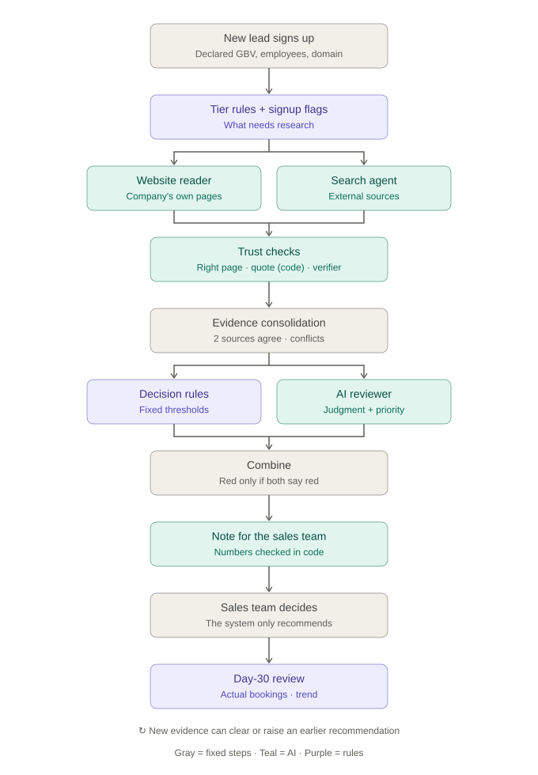

# Lead Tier Routing: Product Spec

*A short spec for the Navan Growth assignment. Technical details are in `system-spec-detailed.md`, prompts and AI testing in `ai-appendix.md`, and the full decision trail in `work-log.md`.*

---

## 1. Why

New customers are routed to a support tier using two inputs:
- the travel spend they **declare**;
- an **estimated** headcount, missing for 20 of the 43 companies.

Both can be wrong, and nothing revisits the decision once real activity starts.

The tier rules themselves are fine. In the dataset, every company's tier matches the rules exactly. **The problem is the inputs.** As a result:
- some companies get less support than they need, and others more;
- fast-growing customers can go unnoticed.

## 2. What the system does

For every new customer, the system works in five steps:

1. **Signup:** sets the tier from the rules and raises first flags.
2. **Research:** reads the company's own website and independent sources (news, company databases).
3. **Prove:** keeps only facts with a quote and a source.
4. **Recommend:** one of three outcomes, with a short note the sales team can check:

| | Meaning | What the sales team does |
|---|---|---|
| 🟢 | The tier fits | Nothing |
| 🟡 | Something needs a look | Review. "High priority" means look soon |
| 🔴 | Strong evidence for a higher tier | Consider moving the customer up |

5. **Re-check:** after 30 days, using real bookings.

**The system never changes a tier. A person always decides.**

## 3. Principles

- **Recommend, don't decide.** Even red is a suggestion.
- **Flags need evidence.** Missing data triggers research, not a recommendation.
- **Every recommendation explains itself**, with sources. This includes green.
- **Rules for numbers, AI for context.** Fixed rules check the hard numbers. AI weighs what rules can't see.
- **AI outputs are verified.** Every quote, link and number in a note is checked in code.
- **Every change is tested.** A change is kept only if it improves the results.

## 4. How it works

### Signup
Four flags compare declared spend with company size. The ratio comes from Navan's own tier rules: $100K ≈ 150 employees, about $667 per employee.

| Flag | Meaning |
|---|---|
| `MISSING_SIZE` | No employee count. Triggers a search for it |
| `GBV_LOW_FOR_SIZE` | Declared spend low for the company size |
| `GBV_HIGH_FOR_SIZE` | Declared spend high for the company size |
| `NEAR_THRESHOLD` | Within 20% below the next tier |

30 of 43 companies get a flag. For 20 of them, the only flag is missing size.

### Research
Two ways to research a company:
- **Website reader:** code finds and downloads the company's info pages. AI extracts the facts.
- **Search agent:** AI decides what to search for. Code keeps only links that really appeared in the search results.

Both look for headcount, industry, countries, parent company, funding and hiring.

**Why two sources:** a company's own website is marketing. An outside source can confirm or contradict it.

### Prove
Before a fact is used, it must pass three checks:
- **Is the page about this company?** (AI, once per page)
- **Is the quote really on the page?** (code)
- **Does the quote support the fact?** (AI)

A number counts as **confirmed** only when two sources agree. 39 of 458 extracted facts were rejected before any decision.

### Recommend
Two independent judges:
- **Rules:** fixed thresholds on verified facts. Research flags: `SIZE_SUGGESTS_HIGHER_TIER`, `SIZE_SUGGESTS_LOWER_TIER`, `SOURCES_CONFLICT` (only across a tier threshold), `HAS_PARENT_COMPANY`, `MULTI_COUNTRY` (3+ countries in Tier 3). The signup flags run again with the verified headcount. Output: 🟢 🟡 🔴.
- **AI reviewer:** weighs everything, including growth pace, dates and conflicting facts. Output: 🟢 🟡 🟠 🔴. Orange means a strong concern to check soon.

**Combine:**
- 🔴 only when both say red.
- Rules 🟢 + AI 🟢 or 🟡 → 🟢.
- AI 🟠 → 🟡, high priority.
- Anything else → 🟡.

### The note for the sales team
At most 2 sentences and 40 words, starting with *why*. Every number in the note is checked in code against the verified facts.

> 🔴 **Consider a higher tier:** Headcount is 190+ (attio.com), 196 (pitchbook.com), and 206 employees (tracxn.com), well above the 24 on file, and the $52M Series B (prnewswire.com) signals growth. Check the employee count in the account record.

### Re-check after 30 days
Bookings × 12 × $300–700 gives a yearly spend **range**, because the cost per booking is assumed.
- 🔴 only if even the low estimate is a higher tier.
- 🟡 if bookings fell 20% or more. Customer success reaches out.

| Company | Before | Day 30 | Why |
|---|---|---|---|
| NexGen Cloud | 🟡 | 🔴 | 318 bookings, $1.1M+ a year: Tier 1 |
| Greyparrot | 🟡 | 🔴 | 151 bookings, $540K+ a year: Tier 1 |
| Puttshack | 🟡 | 🔴 | 140 bookings, $500K+ a year: Tier 1 |
| IMU Biosciences | 🟡 | 🟢 | 57 bookings fit Tier 2 |
| Valarian | 🟡 | 🟢 | 132 bookings fit Tier 1 |
| Callosum | 🟡 | 🟢 | 4 bookings fit Tier 3 |
| Balfour Beatty | 🟢 | 🟢 | 240 bookings fit Tier 1 |
| Attio | 🔴 | 🟡 | May reach Tier 2, not confirmed yet |
| Metaview | 🟡 | 🟡 | Bookings fell 22% |
| Bionical Solutions | 🟡 | 🟡 | Bookings fell 35% |

## 5. What research revealed

| Company | File | Research |
|---|---|---|
| Instinct | $35K declared, Tier 3 | $1B raise at a $10B valuation, 14 employees |
| Attio | 24 employees | 190–206 employees (3 sources) |
| Valarian | 175 employees | 31–32 employees (2 sources) |
| IMU Bio | 155 employees | 25 and 85: the sources disagree too |

## 6. How we tested

**There is no ground truth**, so we checked in three ways:

1. **Independent research:** 5 companies researched by hand, outside the system. Details and sources in `independent-research.md`.
2. **Reality check:** day-30 bookings for 10 companies (section 4).
3. **Checks without an answer key:** all 43 companies, 3 runs each.

**Results:**

| Company | Research | System | Why |
|---|---|---|---|
| Attio | 🔴 | 🔴 | ~175 employees, not 24 |
| Valarian | 🟡 | 🟡 | ~30 employees, not 175 |
| Instinct | 🟡 | 🟡 | $1B raise at $10B |
| Ageas Retail | 🟡 | 🟡 | Part of a larger group |
| Recraft | 🟢 | 🟡 | Fits Tier 2 |

- **4 of 5** match the independent research.
- **93%** of companies got the same color in all 3 runs (40 of 43).
- **39 of 458** facts were rejected by the checks.
- **0** unsupported numbers in notes.

**Where it still fails:**
- **Recraft:** flagged a company that fits its tier, and not the same in every run.
- **Puttshack:** we expected green. Day-30 bookings point to Tier 1, so our own label was wrong.
- **Instinct:** a note called a $50M valuation a "$50 million seed". Code checks that a number exists, not what it means.

**How errors were reduced:** most unneeded flags came from two rule types, any funding round and missing size. Both became notes, not flags. A second fix gave the AI four levels, so only a strong AI concern overrides the rules.

## 7. AI tools used

| Tool | Used for |
|---|---|
| **Claude Code** | Planning, writing the code and web research |
| **ChatGPT** | A second opinion on the plan at the start |
| **Claude Haiku 5.5** | Inside the system, chosen for speed and low cost: choosing searches, extracting facts, checking the right company, verifying quotes, judging the full picture, writing the note |

## 8. What comes next

1. **A large, verified dataset**, to measure results against the truth.
2. **More sources:** official registries such as Companies House, and company databases.
3. **Stronger and backup models:** for example, Claude Opus 5.5, plus a backup if the main one is down.
4. **A re-check every 30 days**, keeping the history to see trends.
5. **A simple interface for sales:** recommendation, evidence and sources in one screen.
6. **Check what numbers mean:** a raise is not a valuation.

## 9. Limitations

- **Small dataset:** 43 companies, and only 5 researched independently.
- **Two key numbers are assumptions, stated openly:** spend per employee (~$667, implied by Navan's own tier rules) and cost per booking ($300–700).
- **The AI reviewer is not perfectly consistent between runs.** The combine rule reduces this, but does not remove it.
- **Headcounts from company databases are estimates.** None of the companies publishes an official number.
- **All customer fields in the dataset are fictional.** Findings about real companies are hypotheses.
